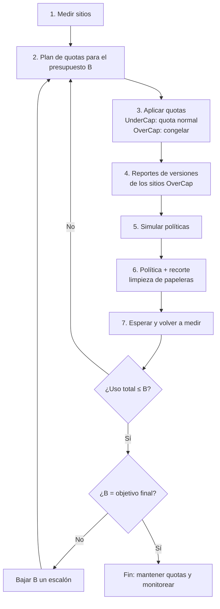

# 🌲 La estrategia detrás de spruce

[English](strategy.md) | **Español**

Este documento explica el método que implementa spruce: por qué trabaja por escalones, qué
palancas usa y para qué sirve cada comando. La instalación y el uso están en el
[README](../README.es.md).

## Objetivo

Bajar el almacenamiento de SharePoint que usa un tenant hasta un presupuesto objetivo (por
ejemplo, de ~6 TB a ~2 TB) en escalones, para que la organización deje de pagar almacenamiento
extra. Se combinan tres palancas:

1. **Quotas por sitio**, para frenar el crecimiento.
2. **Políticas de versiones**, para que el problema no vuelva.
3. **Recorte de versiones existentes**, para liberar espacio ya.

El espacio retenido fuera de los archivos (papeleras de reciclaje y Preservation Hold Library)
es una cuarta fuente de uso que suele pasarse por alto. spruce lo mide y puede vaciar las
papeleras.

Cada escalón baja el presupuesto un poco, y el ciclo se repite hasta llegar al objetivo.

## Conceptos que condicionan el plan

- **Qué cuenta en el uso de un sitio:** la versión actual de cada archivo, todas sus versiones
  anteriores, las dos etapas de la papelera de reciclaje y la Preservation Hold Library (si hay
  políticas de retención). Las versiones suelen ser lo que más pesa: un Excel, PowerPoint o
  archivo CAD que se edita a diario puede guardar cientos de copias completas.
- **Las métricas de uso se actualizan con retraso**, de hasta ~48 horas. Después de recortar,
  hay que esperar antes de volver a medir.
- **Una quota igual o menor al uso actual deja el sitio en solo lectura.** spruce nunca aplica
  una así.
- **Un sitio en solo lectura no puede generar su reporte de versiones**, porque el reporte se
  escribe dentro del mismo sitio. Por eso a los sitios que superan el presupuesto se los
  *congela* con un margen chico, en lugar de bajarlos de golpe a su meta.
- **El recorte de versiones es permanente.** Saltea la papelera y no se puede deshacer sin
  backup.
- **Las versiones bajo retención o retención legal no se liberan**, aunque se recorten.
- **La política y el recorte son cosas distintas:**
  - La política limita las versiones *nuevas*.
  - Un trabajo de recorte (trim job) borra las versiones *existentes*. Cada trabajo aplica un
    solo modo: cantidad, antigüedad o automático.
  - El mínimo de 100 versiones de SharePoint aplica a la política, no al recorte. Recortar por
    debajo de 100 (a 10 o 50) libera más espacio, pero **solo una vez**: con cada edición nueva,
    la política vuelve a acumular versiones hasta 100. spruce lo usa a propósito como
    **recorte temporal agresivo** (ver el paso 6b).

## El ciclo



Cada ronda corre dentro de una **sesión** (`spruce session new "budget 3TB"`), una carpeta que
guarda junto todo lo que se generó en esa ronda. Las rondas nunca se mezclan y se pueden
correr dos en paralelo.

### Paso 1: Medir cada sitio

```bash
spruce sites export
```

Genera `site-storage_<ts>.csv`: URL, título, plantilla, estado de bloqueo, último cambio de
contenido, uso en MB y quota actual de cada sitio. Excluye OneDrive (es otro pool de
almacenamiento) y los sitios de redirección.

### Paso 2: Plan de quotas para un presupuesto B

```bash
spruce quota plan --budget-tb 5 --reserve-percent 10
```

Cálculo sin conexión: no cambia nada en SharePoint.

- **Presupuesto asignable:** B × (1 − reserva). También se resta la quota de los sitios con una
  quota fija acordada (`--fixed-quotas-csv` con `Url,QuotaGB`).
- **Tope c (water-filling):** el valor en el que Σ min(usoᵢ, c) es igual al presupuesto
  asignable. Los sitios chicos no se tocan; solo se recortan los grandes.
- **Estado de cada sitio:**
  - **UnderCap:** recibe una quota normal. Cuán grande depende de la estrategia de quotas (ver
    abajo). Las quotas nunca bajan de `--min-quota-gb` (10 GB por defecto).
  - **OverCap:** quota = uso × (1 + margen de congelamiento). El crecimiento se frena sin
    bloquear el sitio. Su meta es `TargetQuotaMB` = c, y lo que tiene que liberar es
    `ExcessMB`.
  - **Fixed:** la quota viene del CSV de quotas fijas.

Revisar `quota-plan-summary_<ts>.csv`. `QuotaToBudgetRatio` es la suma de las quotas sobre el
presupuesto: en las primeras rondas es mayor a 1, porque los sitios congelados están por encima
de su meta.

**Cómo elegir los escalones de B:** bajar de forma que la cantidad de sitios OverCap sea
manejable en una ronda (dueños con los que se pueda hablar, reportes que se puedan procesar).
Por ejemplo: 5 → 4 → 3 → 2 TB. Bajar por debajo del almacenamiento incluido en las licencias
(1 TB + 10 GB por licencia) no reduce la factura.

#### Estrategias de quotas

La forma de dimensionar los sitios UnderCap es intercambiable (`spruce quota strategies`):

| Estrategia | Quota UnderCap | Compromiso |
|---|---|---|
| `growth-margin` (por defecto) | min(c, uso × (1 + margen de crecimiento)) | Margen para crecer (el 50% por defecto deja el uso por debajo del aviso del 90%), sin darle a cada sitio chico el tope completo. |
| `water-filling` | c | Water-filling clásico: cada sitio puede crecer hasta el tope común. Simple, pero la suma de quotas queda muy por encima del presupuesto. |
| `budget-fill` | min(demanda, c′), donde demanda = uso × (1 + crecimiento) y Σ min(demanda, c′) = presupuesto | Las quotas siguen al presupuesto. El tope es más bajo, así que más sitios quedan OverCap. |

Se pueden calcular planes con distintas estrategias en una misma sesión y compararlos.

### Paso 3: Aplicar las quotas

```bash
spruce quota apply --dry-run
spruce quota apply --over-cap-mode freeze
```

- Requiere **Site storage limits = Manual** en el centro de administración de SharePoint. Pasar
  a manual mantiene los límites existentes; volver a automático lleva todos los sitios a 25 TB.
- Antes de cada cambio, spruce vuelve a leer el uso del sitio y saltea cualquier quota que lo
  bloquearía.
- **Usar `freeze`** (el valor por defecto). Con `skip`, los sitios que superan el presupuesto
  conservan su límite anterior (que puede ser 25 TB) y siguen creciendo.
- **Avisar a los dueños de los sitios OverCap** cuánto tienen que liberar (`ExcessGB`) antes de
  congelarlos.

### Paso 4: Reportes de versiones de los sitios OverCap

```bash
spruce versions report-start --status OverCap
spruce versions report-receive      # repetir cada día hasta que se bajen todos los reportes
```

- SharePoint genera, en segundo plano, un CSV con **una fila por cada versión de cada
  archivo**: tamaño, número de versión, fecha de modificación y `SnapshotDate` (cuándo dejó de
  ser la versión vigente).
- Tarda de uno a varios días por sitio y se escribe en una biblioteca oculta `VersionReports`
  dentro del sitio. **No abrirlo ni editarlo mientras se genera.**
- Este reporte reemplaza la idea de recorrer archivo por archivo con la API: es la fuente
  oficial, no consume cuota de llamadas y trae exactamente los datos necesarios.
- spruce nunca pide un reporte para un sitio que ya tiene uno en curso en cualquier sesión: un
  pedido nuevo lo reemplazaría y se perderían los días ya esperados.

### Paso 5: Simular políticas de versiones (what-if)

```bash
spruce versions whatif --major-version-limit 10,50,100,200 --expire-after-days 0,365,730 \
    --include-file-detail
```

Evalúa todas las combinaciones de límite por cantidad y por antigüedad (`0` = sin límite).
`count100_age365d` significa "100 versiones y nada más viejo que un año". Las reglas son las
mismas que usan las simulaciones y los recortes de Microsoft:

- **La versión actual nunca se borra.**
- **Por cantidad:** se borra una versión cuando hay al menos N versiones mayores más nuevas (la
  actual cuenta).
- **Por antigüedad:** se borra una versión histórica cuando su `SnapshotDate` es anterior a
  hoy − días. Los recortes por antigüedad también borran **todas** las versiones anteriores al
  1/1/2023; eso también se simula.
- **Combinado:** se borra si se cumple cualquiera de las dos reglas.

Los escenarios con menos de 100 versiones se marcan con `TrimOnly = Yes` y muestran tres
números:

- **`FreedMB`:** lo que libera el recorte en el momento.
- **`SustainableFreedMB`:** lo que sigue liberado cuando las versiones vuelven a crecer hasta
  100 (el mismo escenario con 100).
- **`TemporaryFreedMB`:** la diferencia: espacio que se recupera por un tiempo y que la política
  va a volver a ocupar con el uso.

Salidas:

- `version-whatif-sites_<ts>.csv`: una fila por sitio y escenario. Si la sesión tiene un plan,
  agrega `PlanExcessMB`, `CoversExcess` (el escenario alcanza la meta ahora) y
  `CoversExcessLater` (la sigue alcanzando cuando las versiones vuelven a crecer). Un `Yes` /
  `No` en esas dos columnas indica que el sitio también necesita limpieza manual de su dueño.
- `version-whatif-files_<ts>.csv`: una fila por archivo con historial, para encontrar los que
  más pesan.

La suma de las versiones no coincide exactamente con el uso del sitio: el uso también incluye
las papeleras, la Preservation Hold Library y datos de listas. El paso 6c mide esas partes.

**Si ningún escenario cubre el exceso de un sitio:** vaciar su papelera de segunda etapa,
archivarlo (Microsoft 365 Archive), mover o borrar contenido junto con su dueño, o darle una
quota fija mayor y recalcular.

### Paso 6: Política y recorte

Primero la política, para que las versiones nuevas ya respeten el límite:

```bash
spruce versions policy --site URL --major-version-limit 100 --expire-after-days 365 \
    --apply-existing --dry-run
```

Después el recorte. **Es permanente.** Cada trabajo aplica un solo modo, así que "100
versiones y un año" lleva dos pasadas:

```bash
spruce versions trim --site URL --mode count --major-version-limit 100
spruce versions trim --site URL --mode status     # repetir hasta que termine
spruce versions trim --site URL --mode age --delete-before-days 365
```

- Los dos comandos piden escribir una confirmación.
- El mínimo de la política es 100; se rechazan valores menores.
- Primero hay que tener el visto bueno del dueño del sitio y confirmar que no haya requisitos
  de retención en conflicto.
- Después de encolar un recorte, spruce lo vuelve a leer desde SharePoint y lo cancela en el
  acto si el modo o el límite registrados no coinciden con lo pedido.

### Paso 6b: Recorte temporal agresivo (opcional)

Sirve para liberar mucho espacio rápido en los sitios más grandes, mientras sus dueños hacen la
limpieza manual (borrar contenido obsoleto, archivar, reordenar).

1. **Elegir el nivel con la simulación:** mirar `FreedMB` y `TemporaryFreedMB` de los
   escenarios con 10 o 50 versiones.
2. **Dejar la política en 100 o más.** Nunca puede quedar por debajo de 100.
3. **Recortar por debajo del mínimo**, que requiere una opción explícita:

   ```bash
   spruce versions trim --site URL --mode count --major-version-limit 10 --allow-below-policy-minimum
   ```

4. **Avisar al dueño.** Después solo se van a poder restaurar las últimas 10 (o 50) versiones
   de cada archivo. A cambio, tiene un plazo para hacer su limpieza.
5. **Decidir cómo tratar la quota del sitio después** (paso 7): el espacio temporal se vuelve a
   ocupar de a poco, a medida que la gente edita archivos.

### Paso 6c: Papeleras de reciclaje y Preservation Hold Library

```bash
spruce cleanup analyze --status OverCap --detail
spruce cleanup purge-recycle-bin --site URL --stage 2 --older-than-days 30 --dry-run
```

- **Papeleras de reciclaje.** Los archivos borrados quedan en la papelera de primera etapa (los
  usuarios los pueden restaurar) y después en la de segunda etapa, 93 días en total, y cuentan
  en el uso todo ese tiempo. Vaciar la segunda etapa libera espacio en el momento con poco
  impacto. `analyze` muestra, por sitio, los elementos y MB de cada etapa y cuánto se borró
  hace más de 30 días.
- **Preservation Hold Library.** Cuando una política de retención o una retención legal cubre
  un sitio, SharePoint guarda ahí una copia de cada archivo editado o borrado. Puede crecer
  mucho y no se puede limpiar desde el sitio. spruce informa su tamaño; para liberarla hay que
  cambiar la política de retención en Microsoft Purview (un período más corto, o excluir el
  sitio), y la biblioteca se vacía sola en los días siguientes.

### Paso 7: Esperar, volver a medir y ajustar quotas

1. Esperar a que terminen los recortes y después ~48 h para que se actualicen las métricas.
2. Volver a los pasos 1 y 2 **con el mismo B** (una sesión nueva mantiene la ronda aparte).
3. Los sitios que bajaron de c pasan a UnderCap y reciben su quota normal.
4. Los que siguen excedidos se vuelven a congelar **en su nuevo uso**: la quota baja como un
   trinquete y el espacio liberado no se puede volver a llenar.

**Sitios con recorte temporal agresivo.** Si se congelan al ras de su nuevo uso, el rebrote de
versiones (hasta 100) los va a llevar al límite y los va a bloquear mientras la gente trabaja.
Hay dos formas de manejarlo:

- **Con margen para el rebrote:** una quota fija (`--fixed-quotas-csv`) = uso nuevo +
  `TemporaryFreedMB` + margen. El sitio no se bloquea, y el espacio temporal queda "prestado"
  mientras dura la limpieza manual.
- **Como presión deliberada:** congelarlo al ras para que el aviso de quota funcione como
  recordatorio. Solo con el dueño avisado y una fecha para la limpieza, porque el sitio se
  puede bloquear en plena operación.

En los dos casos, cuando el dueño termina la limpieza, se vuelve a medir y el sitio entra al
cálculo normal del paso 2.

### Paso 8: Bajar B y repetir

Cuando el uso total queda por debajo de B y no quedan sitios OverCap, se baja B al siguiente
escalón y se vuelve al paso 2. Al llegar al objetivo final:

- Reducir la compra de almacenamiento extra en el siguiente ciclo de facturación.
- Dejar los pasos 1 y 2 como control periódico (por ejemplo, mensual).

## Configuración inicial del tenant

- **Modo manual de quotas:** centro de administración → Settings → Site storage limits →
  Manual.
- **Quota por defecto para sitios nuevos:** Settings → Site creation, para que los sitios
  nuevos no nazcan con 25 TB.
- **Política de versiones de la organización:** Settings → Version history limits. Aplica a
  sitios y bibliotecas nuevas.

## Riesgos y salvaguardas

| Riesgo | Salvaguarda |
|---|---|
| Un sitio queda en solo lectura | Nunca se aplican quotas iguales o menores al uso actual. Los sitios OverCap se congelan con margen. |
| Borrado irreversible de versiones | Simulación previa, `--dry-run`, confirmación escrita y visto bueno del dueño del sitio. |
| Un recorte por debajo de 100 versiones deja poco historial para restaurar | Requiere `--allow-below-policy-minimum`. Aviso al dueño. Solo en sitios grandes y con plazo de limpieza. |
| Un sitio recortado se bloquea cuando las versiones vuelven a crecer | Quota con un margen igual a `TemporaryFreedMB`, o congelamiento al ras solo con el dueño avisado. |
| SharePoint registra un recorte distinto al pedido | El trabajo se vuelve a leer y se cancela ante cualquier diferencia. |
| Los sitios excluidos siguen creciendo | Usar `freeze`, no `skip`. Definir una quota por defecto para sitios nuevos. |
| Pedidos duplicados de reportes hacen perder días de espera | Se saltean mientras haya un trabajo en curso en cualquier sesión. |
| Medir antes de que se reflejen los cambios | Esperar a que terminen los trabajos y ~48 h antes de volver a medir. |
| La retención impide liberar espacio | Revisar políticas de retención y retenciones legales (tamaño de la Preservation Hold Library) antes de recortar. |
| Actuar sobre los sitios equivocados | Los comandos que actúan sobre sitios no corren sin una selección explícita; `sites select` la muestra antes. |

## Archivos generados (todos CSV, dentro de la carpeta de la sesión)

| Archivo | Comando | Contenido |
|---|---|---|
| `site-storage_<ts>.csv` | `sites export` | Uso y quota actual de cada sitio |
| `quota-plan_<ts>_<estrategia>.csv` | `quota plan` | Estado, quota propuesta, meta y exceso de cada sitio |
| `quota-plan-summary_<ts>_<estrategia>.csv` | `quota plan` | Totales del plan: presupuesto, tope c, exceso total |
| `quota-apply-log_<ts>.csv` | `quota apply` | Quotas aplicadas, salteadas o fallidas |
| `version-report-jobs.csv` | `versions report-start/receive` | Estado de cada reporte de versiones y su archivo local |
| `version-reports/*.csv` | `versions report-receive` | Reportes descargados (formato de Microsoft) |
| `version-whatif-sites_<ts>.csv` | `versions whatif` | Espacio liberable por sitio y escenario |
| `version-whatif-files_<ts>.csv` | `versions whatif` | Espacio liberable por archivo y escenario |
| `version-policy-log_<ts>.csv` | `versions policy` | Políticas de versiones aplicadas |
| `version-trim-log.csv` | `versions trim` | Recortes encolados |
| `cleanup-summary_<ts>.csv` | `cleanup analyze` | Papeleras y Preservation Hold Library por sitio |
| `recycle-bin-items_<ts>.csv`, `preservation-hold-files_<ts>.csv` | `cleanup analyze --detail` | Una fila por elemento / archivo retenido |
| `recycle-bin-purge-log.csv` | `cleanup purge-recycle-bin` | Elementos purgados |
| `history.log` | todos los comandos | Comandos corridos en la sesión |
