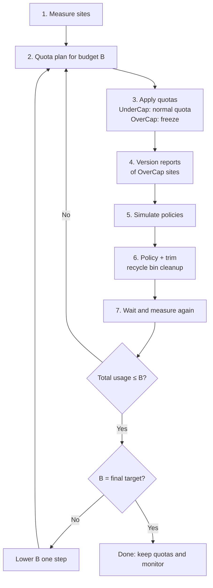

# The strategy behind spruce

**English** | [Español](strategy.es.md)

This document explains the method spruce implements: why it works in steps, which levers it
pulls, and what each command is for. The [README](../README.md) covers installation and usage.

## Goal

Bring the SharePoint storage a tenant uses down to a target budget (for example from ~6 TB to
~2 TB) in steps, so the organization can stop paying for extra storage. Three levers are
combined:

1. **Per-site quotas**, to stop growth.
2. **Version policies**, so the problem does not come back.
3. **Trimming existing versions**, to free space now.

Space held outside the files themselves (recycle bins and the Preservation Hold Library) is a
fourth, often forgotten source of usage. spruce measures it and can purge recycle bins.

Each step lowers the budget a little, and the cycle repeats until the target is reached.

## Concepts that shape the plan

- **What counts toward a site's usage:** the current version of every file, all its previous
  versions, both recycle bin stages and the Preservation Hold Library (when retention policies
  apply). Versions are usually the largest part: an Excel, PowerPoint or CAD file edited daily
  can hold hundreds of full copies.
- **Usage metrics lag** by up to ~48 hours. After trimming, wait before measuring again.
- **A quota at or below current usage makes the site read-only.** spruce never applies one.
- **A read-only site cannot generate its version report**, because the report is written inside
  the site. That is why over-budget sites are *frozen* with a small margin instead of being cut
  to their target at once.
- **Trimming versions is permanent.** It bypasses the recycle bin and cannot be undone without a
  backup.
- **Versions under retention or legal hold are not freed**, even when trimmed.
- **Policy and trim are different things:**
  - The policy limits *new* versions.
  - A trim job deletes *existing* versions. Each job applies a single mode: count, age or
    automatic.
  - SharePoint's minimum of 100 versions applies to the policy, not to the trim. Trimming below
    100 (to 10 or 50) frees more space, but **only once**: with every new edit the policy lets
    versions accumulate again up to 100. spruce uses this on purpose as a **temporary
    aggressive trim** (see step 6b).

## The cycle



Each round runs inside a **session** (`spruce session new "budget 3TB"`), a folder that keeps
every report of that round together. Rounds never mix and two can run in parallel.

### Step 1: Measure every site

```bash
spruce sites export
```

Writes `site-storage_<ts>.csv`: URL, title, template, lock state, last content change, used MB
and current quota of every site. OneDrive (a separate storage pool) and redirect sites are left
out.

### Step 2: Quota plan for a budget B

```bash
spruce quota plan --budget-tb 5 --reserve-percent 10
```

Offline calculation; nothing changes in SharePoint.

- **Assignable budget:** B × (1 − reserve). Sites with an agreed fixed quota
  (`--fixed-quotas-csv` with `Url,QuotaGB`) are subtracted too.
- **Cap c (water-filling):** the value where Σ min(usedᵢ, c) equals the assignable budget. Small
  sites are not touched; only the large ones are cut down.
- **Status of each site:**
  - **UnderCap:** gets a normal quota. How large depends on the quota strategy (below). Quotas
    never go below `--min-quota-gb` (10 GB by default).
  - **OverCap:** quota = used × (1 + freeze margin). Growth stops without locking the site. Its
    goal is `TargetQuotaMB` = c, and what it must free is `ExcessMB`.
  - **Fixed:** quota from the fixed quotas CSV.

Check `quota-plan-summary_<ts>.csv`. `QuotaToBudgetRatio` is the sum of quotas over the budget:
in the first rounds it is above 1, because the frozen sites sit above their target.

**Choosing the steps of B:** lower it so the number of OverCap sites stays manageable in one
round (owners you can talk to, reports you can process). For example 5 → 4 → 3 → 2 TB. Going
below the storage included in your licenses (1 TB + 10 GB per license) does not lower the bill.

#### Quota strategies

How UnderCap sites are sized is pluggable (`spruce quota strategies`):

| Strategy | UnderCap quota | Trade-off |
|---|---|---|
| `growth-margin` (default) | min(c, used × (1 + growth margin)) | Room to grow (50% by default keeps usage under the 90% warning), without giving every small site the whole cap. |
| `water-filling` | c | Classic water-filling: every site may grow up to the shared cap. Simple, but the sum of quotas is far above the budget. |
| `budget-fill` | min(demand, c′), where demand = used × (1 + growth) and Σ min(demand, c′) = budget | Quotas follow the budget. The cap is lower, so more sites become OverCap. |

Plans from different strategies can be computed in the same session and compared side by side.

### Step 3: Apply the quotas

```bash
spruce quota apply --dry-run
spruce quota apply --over-cap-mode freeze
```

- Requires **Site storage limits = Manual** in the SharePoint admin center. Switching to manual
  keeps the existing limits; switching back to automatic resets every site to 25 TB.
- Before each change spruce re-reads the site's usage and skips any quota that would lock it.
- **Use `freeze`** (the default). With `skip`, over-budget sites keep their old limit (possibly
  25 TB) and keep growing.
- **Tell the owners of OverCap sites** how much they must free (`ExcessGB`) before freezing.

### Step 4: Version reports for the OverCap sites

```bash
spruce versions report-start --status OverCap
spruce versions report-receive      # repeat daily until every report is downloaded
```

- SharePoint generates, in the background, a CSV with **one row per version of every file**:
  size, version number, modification date and `SnapshotDate` (when it stopped being current).
- It takes from one to several days per site and is written to a hidden `VersionReports`
  library inside the site. **Do not open or edit it while it is being generated.**
- This report replaces walking every file through the API: it is the official source, does not
  consume API quota and has exactly the data needed.
- spruce never requests a report for a site that already has one running in any session; a new
  request would supersede it and lose the days already waited.

### Step 5: Simulate version policies (what-if)

```bash
spruce versions whatif --major-version-limit 10,50,100,200 --expire-after-days 0,365,730 \
    --include-file-detail
```

Evaluates every combination of count limit and age limit (`0` = no limit). `count100_age365d`
means "100 versions and nothing older than a year". The rules are the ones Microsoft's own
simulations and trims use:

- **The current version is never deleted.**
- **By count:** a version is deleted when at least N newer major versions exist (the current
  one counts).
- **By age:** a historical version is deleted when its `SnapshotDate` is older than today − days.
  Age trims also delete **every** version from before 2023-01-01; that is simulated too.
- **Combined:** deleted if either rule applies.

Scenarios below 100 versions are marked `TrimOnly = Yes` and report three numbers:

- **`FreedMB`:** what the trim frees right away.
- **`SustainableFreedMB`:** what stays free once versions grow back to 100 (the same scenario
  at 100).
- **`TemporaryFreedMB`:** the difference: space recovered for a while, which the policy will
  fill again with use.

Outputs:

- `version-whatif-sites_<ts>.csv`: one row per site and scenario. With a plan in the session it
  adds `PlanExcessMB`, `CoversExcess` (the scenario reaches the target now) and
  `CoversExcessLater` (it still does after versions grow back). `Yes` / `No` in those two columns
  means the site also needs manual cleanup by its owner.
- `version-whatif-files_<ts>.csv`: one row per file with history, to find the heaviest ones.

The sum of versions does not match the site's usage exactly: usage also includes recycle bins,
the Preservation Hold Library and list data. Step 6c measures those.

**If no scenario covers a site's excess:** empty its second-stage recycle bin, archive it
(Microsoft 365 Archive), move or delete content with its owner, or give it a larger fixed quota
and recompute.

### Step 6: Policy and trim

Policy first, so new versions already respect the limit:

```bash
spruce versions policy --site URL --major-version-limit 100 --expire-after-days 365 \
    --apply-existing --dry-run
```

Then the trim. **It is permanent.** Each job applies one mode, so "100 versions and one year"
takes two passes:

```bash
spruce versions trim --site URL --mode count --major-version-limit 100
spruce versions trim --site URL --mode status     # repeat until it finishes
spruce versions trim --site URL --mode age --delete-before-days 365
```

- Both commands ask for a typed confirmation.
- The policy minimum is 100; lower values are rejected.
- Get the site owner's approval first, and check there are no retention requirements in
  conflict.
- After queuing a trim, spruce reads the job back from SharePoint and cancels it immediately if
  the registered mode or limit differs from the request.

### Step 6b: Temporary aggressive trim (optional)

Frees a lot of space fast on the largest sites while their owners do the manual cleanup
(delete obsolete content, archive, reorganize).

1. **Pick the level with the simulation:** look at `FreedMB` and `TemporaryFreedMB` of the 10
   or 50 version scenarios.
2. **Keep the policy at 100 or more.** It can never go below 100.
3. **Trim below the minimum**, which needs an explicit flag:

   ```bash
   spruce versions trim --site URL --mode count --major-version-limit 10 --allow-below-policy-minimum
   ```

4. **Tell the owner.** Afterwards only the last 10 (or 50) versions of each file can be
   restored. In exchange they get time to clean up.
5. **Decide how to handle the site's quota afterwards** (step 7): the temporary space fills
   again little by little as people edit files.

### Step 6c: Recycle bins and Preservation Hold Library

```bash
spruce cleanup analyze --status OverCap --detail
spruce cleanup purge-recycle-bin --site URL --stage 2 --older-than-days 30 --dry-run
```

- **Recycle bins.** Deleted files stay in the first-stage bin (users can restore them) and then
  in the second-stage bin, for 93 days in total, and count toward usage the whole time. Purging
  the second stage frees space at once with little impact. `analyze` shows, per site, items and
  MB in each stage and how much was deleted more than 30 days ago.
- **Preservation Hold Library.** When a retention policy or hold covers a site, SharePoint keeps
  a copy of every edited or deleted file there. It can grow large and cannot be cleaned from the
  site. spruce reports its size; freeing it means changing the retention policy in Microsoft
  Purview (shorter period, or excluding the site), after which the library empties over the
  following days.

### Step 7: Wait, measure again, adjust quotas

1. Wait for the trim jobs to finish and then ~48 h for the metrics to refresh.
2. Back to steps 1 and 2 **with the same B** (a new session keeps the round apart).
3. Sites that dropped below c become UnderCap and get their normal quota.
4. Sites still over are frozen again **at their new usage**: the quota goes down like a ratchet
   and the freed space cannot fill up again.

**Sites with a temporary aggressive trim.** Frozen flush with their new usage, the versions
growing back (up to 100) will push them to the limit and lock them while people work. Two ways
to handle it:

- **With room for the regrowth:** a fixed quota (`--fixed-quotas-csv`) = new usage +
  `TemporaryFreedMB` + margin. The site is not locked, and the temporary space is "lent" while
  the manual cleanup lasts.
- **As deliberate pressure:** freeze it flush so the quota warning works as a reminder. Only
  with an informed owner and a cleanup deadline, because the site can lock mid-operation.

Either way, once the owner finishes the cleanup, measure again and the site re-enters the
normal calculation of step 2.

### Step 8: Lower B and repeat

When total usage is below B and there are no OverCap sites left, lower B to the next step and go
back to step 2. At the final target:

- Reduce the extra storage purchase in the next billing cycle.
- Keep steps 1 and 2 as a periodic check (for example monthly).

## One-time tenant setup

- **Manual quota mode:** admin center → Settings → Site storage limits → Manual.
- **Default quota for new sites:** Settings → Site creation, so new sites are not born with 25 TB.
- **Organization version policy:** Settings → Version history limits. Applies to new sites and
  libraries.

## Risks and safeguards

| Risk | Safeguard |
|---|---|
| A site becomes read-only | Quotas at or below current usage are never applied. OverCap sites are frozen with a margin. |
| Irreversible deletion of versions | Simulation first, `--dry-run`, typed confirmation and the site owner's approval. |
| A trim below 100 versions leaves little history to restore | Needs `--allow-below-policy-minimum`. Warn the owner. Only on large sites with a cleanup deadline. |
| A trimmed site locks when versions grow back | Quota with a margin equal to `TemporaryFreedMB`, or flush freeze only with an informed owner. |
| SharePoint registers a different trim than requested | The job is read back and cancelled on any mismatch. |
| Excluded sites keep growing | Use `freeze`, not `skip`. Set a default quota for new sites. |
| Duplicate version report requests lose days of waiting | Requests are skipped while a job runs in any session. |
| Measuring before changes are reflected | Wait for jobs to finish and ~48 h before measuring again. |
| Retention prevents freeing space | Check retention policies and holds (Preservation Hold Library size) before trimming. |
| Acting on the wrong sites | Commands that act on sites refuse to run without an explicit selection; `sites select` previews it. |

## Files produced (all CSV, inside the session folder)

| File | Command | Content |
|---|---|---|
| `site-storage_<ts>.csv` | `sites export` | Usage and current quota per site |
| `quota-plan_<ts>_<strategy>.csv` | `quota plan` | Status, proposed quota, target and excess per site |
| `quota-plan-summary_<ts>_<strategy>.csv` | `quota plan` | Plan totals: budget, cap c, total excess |
| `quota-apply-log_<ts>.csv` | `quota apply` | Quotas applied, skipped or failed |
| `version-report-jobs.csv` | `versions report-start/receive` | State of each version report and its local file |
| `version-reports/*.csv` | `versions report-receive` | Downloaded reports (Microsoft's format) |
| `version-whatif-sites_<ts>.csv` | `versions whatif` | Space freed per site and scenario |
| `version-whatif-files_<ts>.csv` | `versions whatif` | Space freed per file and scenario |
| `version-policy-log_<ts>.csv` | `versions policy` | Version policies applied |
| `version-trim-log.csv` | `versions trim` | Trim jobs queued |
| `cleanup-summary_<ts>.csv` | `cleanup analyze` | Recycle bins and Preservation Hold Library per site |
| `recycle-bin-items_<ts>.csv`, `preservation-hold-files_<ts>.csv` | `cleanup analyze --detail` | One row per item / held file |
| `recycle-bin-purge-log.csv` | `cleanup purge-recycle-bin` | Items purged |
| `history.log` | every command | Commands run in the session |
